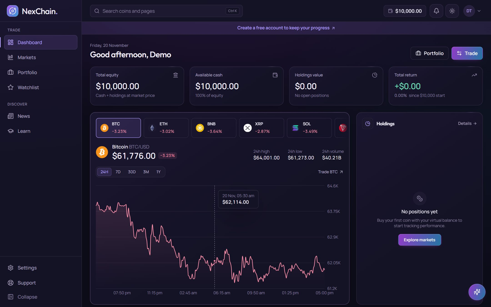
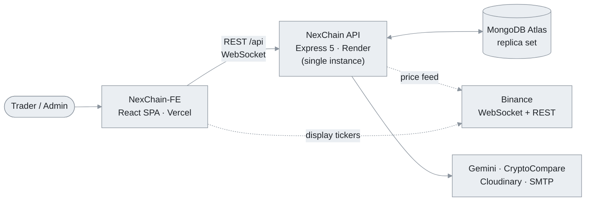
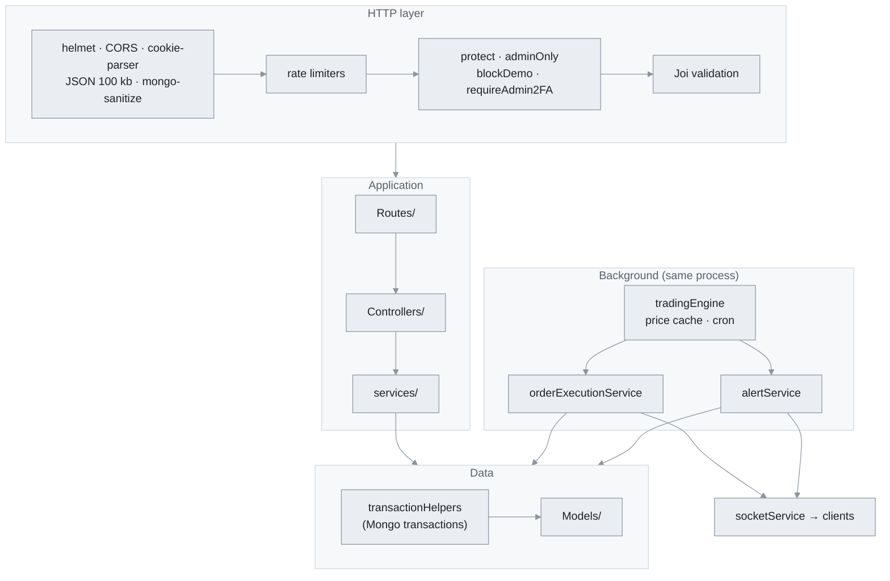
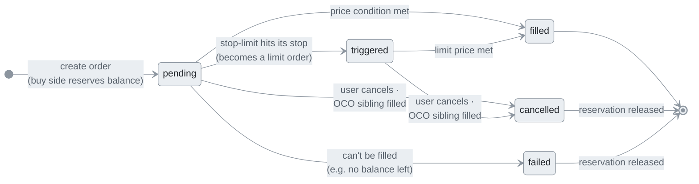
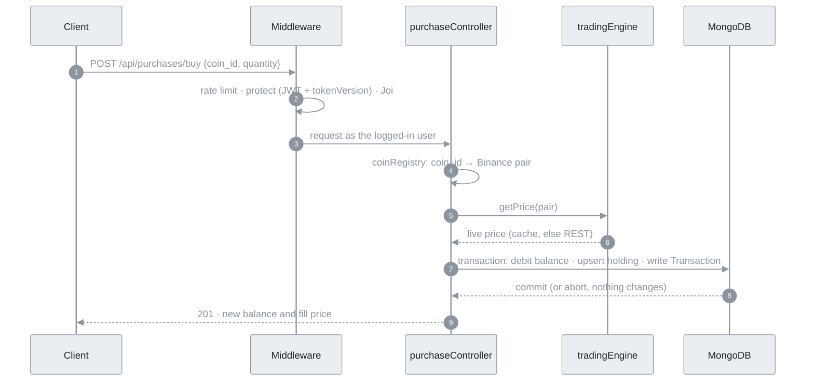
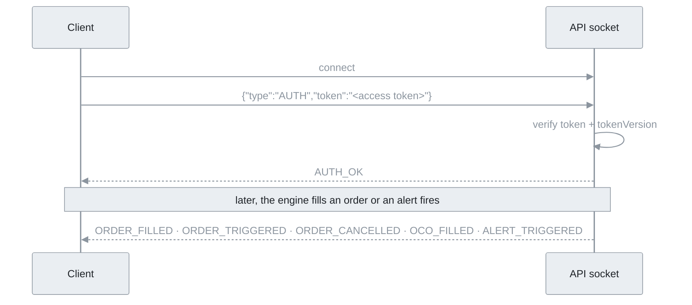
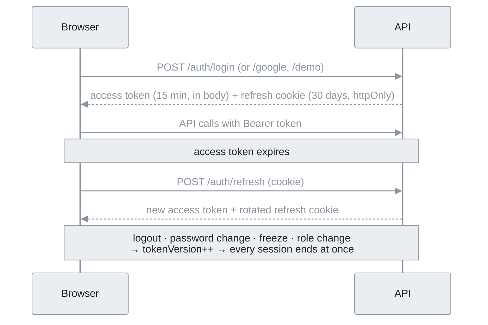
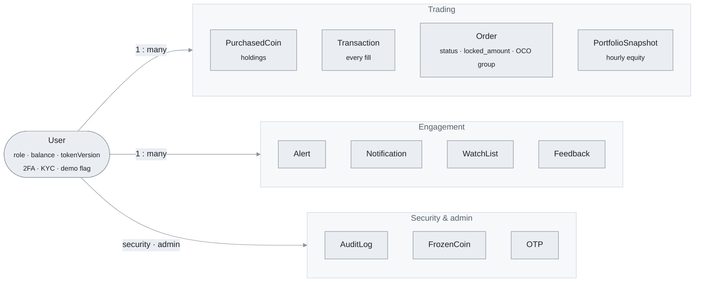
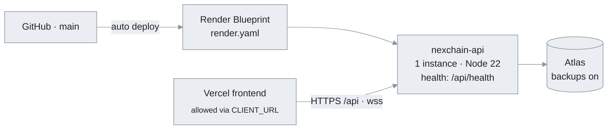

<div align="center">


<br>


**[Quick start](#-quick-start)** &nbsp;·&nbsp; **[Architecture](#-architecture)** &nbsp;·&nbsp; **[API](#-api-reference)** &nbsp;·&nbsp; **[Configuration](#-configuration)** &nbsp;·&nbsp; **[Deploy](#-deploying-to-render)** &nbsp;·&nbsp; **[Help](#-troubleshooting)**

<sub>Frontend → <a href="https://github.com/Arjunsathia/NexChain-FE"><b>NexChain-FE</b></a></sub>

</div>

<br>

## ◆ Overview

NexChain is a crypto **paper-trading** platform. Every user starts with **$10,000 of virtual money** and trades it against **live Binance prices**, using the same order types a real exchange offers. No real funds are involved.

**This repository is the API.** It handles:

- accounts and sessions
- balances and trades
- the order-matching engine
- price alerts and real-time events
- the admin console's data

<p align="center">
  
  <br>
  <sub>The trading dashboard: every number on it comes from this API and the live price feed.</sub>
</p>

<table width="100%">
<tr>
<td width="50%" valign="top">

#### For traders

- Market buys and sells at the server's live price
- Limit, stop-limit, stop-market and **OCO** orders
- Price alerts by socket, in-app notification and email
- Portfolio history, leaderboard, watchlist, news
- AI assistant (Gemini) with live price and news lookups
- One-click **demo accounts**, no sign-up needed

</td>
<td width="50%" valign="top">

#### For admins

- User management: roles, freeze, delete
- Freeze or unfreeze individual coins
- KYC review with private document access
- Feedback and support inbox
- Platform stats and today's transactions
- Audit log, plus **2FA** for destructive actions

</td>
</tr>
</table>

<details>
<summary><b>Contents</b></summary>
<br>

| | | |
|---|---|---|
| [Quick start](#-quick-start) | [API reference](#-api-reference) | [Scripts](#-scripts) |
| [Architecture](#-architecture) | [Data model](#-data-model) | [Project structure](#-project-structure) |
| [Engineering guarantees](#-engineering-guarantees) | [Configuration](#-configuration) | [Deploying to Render](#-deploying-to-render) |
| [Security](#-security) | [Limits and next steps](#-limits-and-next-steps) | [Troubleshooting](#-troubleshooting) |

</details>

<br>

## ◆ Quick start

> [!NOTE]
> **Requirements:** Node.js 20 or newer. That's all for development: `npm run dev` brings its own database.

```bash
npm install
cp .env.example .env     # fill in the four required secrets (see Configuration)
npm run dev              # → http://localhost:4001
```

<table>
<tr>
<td width="55%" valign="top">

**What `npm run dev` does**

1. Starts a private **MongoDB replica set** on port `27027`, with its data in `.local-db/` or `LOCAL_DB_PATH`
2. Seeds the dev accounts
3. Runs the API with auto-reload (nodemon)
4. Blanks the Cloudinary and email keys, so nothing reaches real accounts

**Ctrl+C stops everything.** Leftovers from a killed run are cleaned up next time. A busy port is reported with the exact command to free it. If the database dies, the API stops too, with one clear message.

</td>
<td width="45%" valign="top">

**Dev accounts** · password `Password123`

| Username | Role |
|---|---|
| `superadmin` | superadmin |
| `admin` | admin |
| `testuser` | user |

Emails: `superadmin@`, `admin@`, `user@` + `nexchain.local`

</td>
</tr>
</table>

> [!TIP]
> - **Project inside OneDrive or Dropbox?** Set `LOCAL_DB_PATH=C:/nexchain-db` in `.env`. Syncing can lock MongoDB's files.
> - **Using your own database** (Atlas, or `mongod --replSet rs0`)? Set `MONGO_URI` and run `npm run dev:own-db`.

<br>

## ◆ Architecture

### System context



The browser gets live tickers straight from Binance for display. **Every trade is priced by the server's own feed**, so a client can never choose its price.

### Inside the API



| Layer | Responsibility |
|---|---|
| **Middleware** | Security headers, CORS, sanitising, rate limits, authentication and roles, request validation |
| **Routes → Controllers** | Map URLs to handlers. Controllers stay thin and always act as the logged-in user, never a `user_id` from the request |
| **Services** | Business logic: trading engine, order execution, alerts, sockets, chat, equity snapshots, demo accounts |
| **Data** | Mongoose models. Every money movement goes through `utils/transactionHelpers.js` |

### Trading engine

`services/tradingEngine.js` drives everything time-based inside the web process:

| Job | Runs | What it does |
|---|---|---|
| **Price feed** | always | One Binance WebSocket for every tracked coin, with REST fallbacks. Reconnects with backoff and switches hosts when one is blocked |
| **Symbol sync** | every 30 s | Subscribes to coins that have open orders or active alerts |
| **Order matching** | every 5 s | Fills pending orders whose coin has a price under 20 s old, oldest first, at most 500 per tick |
| **Alert checks** | each price tick | Throttled to once per 2 s per coin. Each alert fires exactly once |
| **Portfolio snapshots** | hourly | Data points for the performance chart |
| **Demo purge** | hourly | Deletes expired demo accounts and all their data |

While the database is unreachable, these jobs **pause**, and they resume on reconnect, with one log line each way. Repeated errors collapse into one summary line every 30 s.

> [!IMPORTANT]
> Run **exactly one instance** with the engine on, or orders get processed twice. Set `ENGINE_ENABLED=false` on any extra instance.

### Order lifecycle



### A trade, end to end



### Real-time events



- **No token in the URL.** It goes in the first message, so proxies and logs never record it.
- **Unauthenticated sockets** are closed after 10 s.
- **Dead connections** are dropped by a 30 s heartbeat.

### Sessions



<br>

## ◆ Engineering guarantees

| Guarantee | How it's enforced |
|---|---|
| **No partial balance updates** | Every money movement runs in a MongoDB transaction with atomic updates (`utils/transactionHelpers.js`). This is why a replica set is required |
| **An order never fills twice** | The order is claimed and filled in the same transaction. OCO legs cancel each other atomically |
| **Reserved funds can't be double-spent** | Buy orders lock their amount (`locked_amount`). It's released on cancel or failure |
| **No client-chosen prices** | The Binance pair is derived from the coin id on the server (`services/coinRegistry.js`). Fills use the server's feed |
| **Stale prices never fill orders** | Matching only uses prices under 20 s old |
| **An alert fires once** | It's claimed atomically (`active → triggered`) before any notification or email is sent |
| **Outages stay quiet** | Background jobs pause while the database is down, and errors are rate-limited in the log |
| **Clean shutdown** | On SIGTERM: stop the jobs, close the sockets, finish in-flight requests, then disconnect |

<br>

## ◆ Security

| Area | Details |
|---|---|
| **Tokens** | 15-minute access tokens, plus a 30-day **httpOnly refresh cookie** that rotates on every use |
| **Revocation** | `tokenVersion` is checked on every request and socket, so revoking it takes effect immediately |
| **Roles** | `user`, `admin`, `superadmin`. Destructive admin actions also need a TOTP code |
| **2FA** | TOTP, with secrets encrypted at rest using AES-256-GCM (`utils/secretBox.js`) |
| **Input** | Joi schemas, Mongo operator sanitising, 100 kb body limit, helmet headers |
| **Rate limits** | Login (per IP **and** account), OTP, password reset, Google sign-in, refresh, feedback, demo creation, chat |
| **Files** | KYC documents go to private storage, readable only through an admin endpoint |
| **Email** | User-supplied text is HTML-escaped (`utils/escapeHtml.js`) |
| **Audit** | Admin actions (role changes, deletes, KYC decisions, contact) are written to `AuditLog` |

### Demo accounts

`POST /api/auth/demo` (5 per IP per hour) creates a private sandbox user with the usual $10k (`services/demoService.js`).

| Demo users | |
|---|---|
| **Can** | Trade, set alerts, use the watchlist |
| **Can't** (`blockDemo`) | Change email, username, phone or password; upload files; enable 2FA; submit KYC; email support |
| **Lifetime** | Hidden from the leaderboard. Sessions end after 24 h, then the hourly purge deletes everything |

Set `DEMO_ENABLED=false` to turn the endpoint off.

<br>

## ◆ API reference

Everything lives under `/api`. &nbsp; 🔒 signed in &nbsp;·&nbsp; 🛡 admin

| Prefix | Purpose |
|---|---|
| `/auth` | Register, login, Google sign-in, email OTP, refresh, logout, password reset, demo |
| `/users` | Profile, settings, leaderboard · 🛡 user management |
| `/purchases` | 🔒 Market `buy` / `sell`, balance, holdings, transactions, performance, reset · 🛡 platform stats |
| `/orders` | 🔒 Create limit/stop orders, `create-oco`, update, cancel, list open orders |
| `/alerts` | 🔒 Create, list and delete price alerts |
| `/watchlist` | 🔒 Add, remove and list coins |
| `/notifications` | 🔒 List, mark read, clear |
| `/kyc` | 🔒 Submit and check status · 🛡 review, view the document, verify or reject |
| `/coins` | Frozen-coin list, start tracking a coin's price · 🛡 freeze and unfreeze |
| `/feedback` | Public feedback (validated, rate limited) · 🛡 inbox |
| `/news` | Crypto news (CryptoCompare) |
| `/chat` | AI assistant (Gemini, with live price and news tools) |
| `/2fa` | 🔒 Set up, verify and disable TOTP |
| `/health` | Public. Database and price-feed status; **503** when the database is down |

<details>
<summary><b>Example: <code>GET /api/health</code></b></summary>
<br>

```json
{
  "status": "ok",
  "uptimeSeconds": 47,
  "db": { "ok": true, "latencyMs": 1 },
  "priceFeed": { "connected": true, "freshSymbols": 28, "trackedSymbols": 30 }
}
```

</details>

<br>

## ◆ Data model



| Model | Holds |
|---|---|
| `User` | Account, role, virtual balance, `tokenVersion`, 2FA, KYC status, demo flag |
| `PurchasedCoin` | Current holdings per user and coin |
| `Transaction` | Every fill, from market trades and orders |
| `Order` | `market` · `limit` · `stop_limit` · `stop_market`, with status, reserved amount and OCO group |
| `Alert` | `above` / `below` a target, `active` / `triggered` |
| `Notification` | In-app notifications |
| `PortfolioSnapshot` | Hourly equity points for the chart |
| `WatchList` · `FrozenCoin` · `Feedback` · `OTP` · `AuditLog` | Watchlist, admin coin freezes, support, email codes, admin audit trail |

<br>

## ◆ Configuration

`.env.example` documents every variable. The server **refuses to start** without the required ones.

| Required | Purpose |
|---|---|
| `MONGO_URI` | Replica-set connection string (set for you by `npm run dev`) |
| `JWT_SECRET`, `JWT_REFRESH_SECRET` | Access and refresh token signing. They must differ. Generate with `openssl rand -hex 32` |
| `OTP_SECRET` | Email verification codes |
| `TOTP_ENC_KEY` | Encrypts stored 2FA secrets. Changing it invalidates everyone's 2FA |

<details>
<summary><b>Production and integrations</b></summary>
<br>

| Variable | Needed for | Purpose |
|---|---|---|
| `CLIENT_URL`, `CORS_ORIGINS` | production | Frontend origin(s) allowed by CORS. `CLIENT_URL` is also used in email links |
| `CLOUDINARY_*` | production | Avatars and private KYC files. Without it, files go to local disk, which Render wipes on deploy |
| `EMAIL_USER`, `EMAIL_PASS`, `SMTP_*` | email | OTP, password reset and alert emails (Gmail needs an App Password) |
| `SUPPORT_EMAIL` | – | Inbox for "Contact support" (defaults to `EMAIL_USER`) |
| `GOOGLE_CLIENT_ID` | Google login | Must equal the frontend's `VITE_GOOGLE_CLIENT_ID` |
| `GEMINI_API_KEY` | AI chat | `GEMINI_MODELS` overrides the model fallback order |
| `CRYPTO_COMPARE_API_KEY` | – | Higher news-feed rate limit |
| `BINANCE_WS_URL` | – | Price-stream host to try first |

</details>

<details>
<summary><b>Switches and local development</b></summary>
<br>

| Variable | Purpose |
|---|---|
| `ENGINE_ENABLED` | `false` runs the API without the order engine and cron jobs |
| `DEMO_ENABLED` | `false` turns off demo accounts |
| `LOCAL_DB_PATH` | Data folder for `npm run dev`'s database (default `.local-db/`) |
| `LOCAL_DB_CACHE_GB` | Memory cap for `npm run dev`'s database cache (default `0.25`) |
| `LOCAL_AI` | `off` starts `npm run dev` with the AI assistant offline |

</details>

<br>

## ◆ Scripts

| Command | What it does |
|---|---|
| `npm run dev` | Local development: private database, seeded accounts, auto-reload |
| `npm run dev:own-db` | Auto-reload against the `MONGO_URI` in `.env` |
| `npm start` | Production start (what Render runs) |
| `npm test` | Jest + Supertest against an in-memory MongoDB replica set |
| `npm run lint` | ESLint |
| `npm run seed` | Create the dev accounts (refuses production and non-local databases) |
| `npm run audit:balances` | **Read-only** report of data left by the old exploits |
| `npm run migrate:orders` | One-time fix-up of old open orders. Dry run by default; add `-- --apply` to write |

**Tests** cover auth, sessions, trading, orders, OCO, KYC, security rules, the price feed and alerts. CI runs lint and the full suite on every push and pull request.

<br>

## ◆ Project structure

```text
NexChain-backend/
├── server.js        Express app, middleware, routes, startup, graceful shutdown
├── config/          env checks, DB connection, core coin list
├── Routes/          URL → middleware → controller
├── Controllers/     request handling
├── services/        trading engine, order execution, alerts, sockets, chat, equity, demo
├── Models/          Mongoose schemas
├── middleware/      auth (protect, adminOnly, blockDemo, 2FA), validation, rate limits, uploads
├── utils/           transactions, tokens, order locks, email, encryption, logging
├── scripts/         dev launcher, seed, audits, migrations
└── tests/           Jest suites
```

<br>

## ◆ Deploying to Render



1. **Create the service** from `render.yaml` and fill in the `sync: false` variables. JWT, OTP and TOTP secrets are generated for you.
2. **Set `CLIENT_URL`** (plus `CORS_ORIGINS` for several origins) to the deployed frontend URL.
3. **Prepare Atlas:**
   - Create a dedicated database user.
   - Allow Render's outbound IPs (or `0.0.0.0/0` with a strong password).
   - Turn on backups.
4. **Keep one instance.** The blueprint pins `numInstances: 1`.

> [!WARNING]
> **Before the first production deploy of this hardened version:**
> 1. Back up the database.
> 2. Run `npm run audit:balances`.
> 3. Run `npm run migrate:orders`, review the dry run, then run it again with `-- --apply`.
>
> Everyone will need to log in once, because the token format changed.

<br>

## ◆ Limits and next steps

| Today | Why | Next step |
|---|---|---|
| The engine runs inside the web process | Simple to deploy, but it forces a single instance | Move the engine to a worker process that holds a lock, so the web tier can scale |
| Rate limits are kept in memory | The default store: limits reset on restart and aren't shared | Use a shared store (e.g. Redis) once there's more than one instance |
| Uploads fall back to local disk without Cloudinary | Fine locally, but Render's disk is wiped on every deploy | Keep `CLOUDINARY_*` set in every deployed environment |
| Prices depend on Binance | Some regions block `binance.com` | Already falls back to `data-stream.binance.vision`; add another provider if needed |

<br>

## ◆ Troubleshooting

<details>
<summary><b>A flood of <code>connect ECONNREFUSED 127.0.0.1:27027</code></b></summary>
<br>

The local dev database stopped while the API kept running. Press Ctrl+C and run `npm run dev` again. The launcher now detects this, stops the API and tells you.
</details>

<details>
<summary><b>The local database stopped unexpectedly (exit code 14)</b></summary>
<br>

That's MongoDB running out of memory (its log says `out of memory`). This happens when the computer is low on RAM. `npm run dev` now caps the database cache at 256 MB, which is plenty for dev data.

If it still happens, close some heavy apps (browsers, other IDEs), or lower the cap further with `LOCAL_DB_CACHE_GB=0.1`. If the project lives in OneDrive or Dropbox, also set `LOCAL_DB_PATH` to a folder outside it.
</details>

<details>
<summary><b><code>Port 4001</code> or <code>27027</code> is already in use</b></summary>
<br>

Another copy is still running. The error names the process and gives the exact `taskkill` (Windows) or `kill` command to stop it.
</details>

<details>
<summary><b>Trades fail with a transaction error</b></summary>
<br>

Your MongoDB is a standalone server. Trades need a replica set: use `npm run dev`, Atlas, or `mongod --replSet rs0`.
</details>

<details>
<summary><b>No live prices</b></summary>
<br>

That Binance host is probably blocked on your network. The engine switches hosts on its own, and you can pin one with `BINANCE_WS_URL`. `GET /api/health` → `priceFeed` shows the current state.
</details>

<details>
<summary><b>The AI assistant says it's busy</b></summary>
<br>

Gemini is rate limiting or overloaded. The assistant falls back through `GEMINI_MODELS` and skips a failing model for a minute. Start dev with `LOCAL_AI=off` to work without it.
</details>

<br>

<div align="center">
<sub><b>NexChain</b> &nbsp;·&nbsp; <a href="https://github.com/Arjunsathia/NexChain-FE">Frontend</a> &nbsp;·&nbsp; <a href="https://github.com/Arjunsathia/NexChain-backend">Backend</a></sub>
</div>
