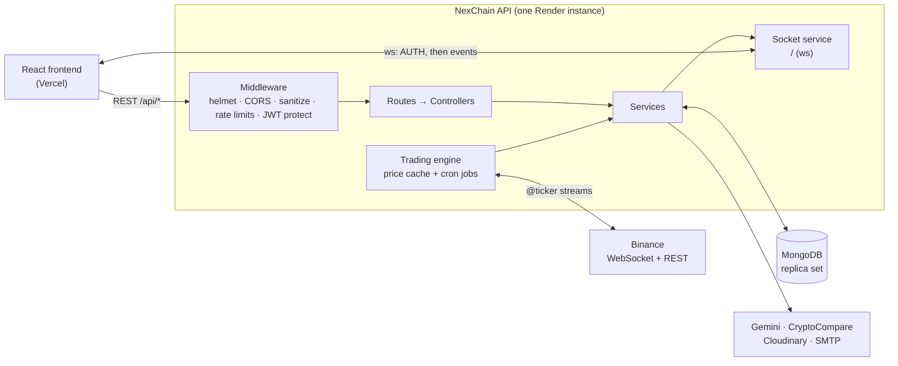

<div align="center">

# ⚡ NexChain API

**The backend of NexChain, a crypto paper-trading platform.**
Trade with virtual money against live Binance prices: no real funds, real market behaviour.


[Quick start](#-quick-start) · [Architecture](#-architecture) · [API map](#-api-map) · [Configuration](#-configuration) · [Deploying](#-deploying-render) · [Troubleshooting](#-troubleshooting)

Frontend: [NexChain-FE](../NexChain-FE)

</div>

---

## ✨ What it does

| For traders | For admins |
|---|---|
| 💵 $10,000 virtual balance, resettable | 👥 User management: roles, freeze, delete |
| 📈 Market buys and sells at the live server price | 🪙 Freeze or unfreeze coins for trading |
| 🎯 Limit, stop-limit, stop-market and **OCO** orders | 🪪 KYC review with private document access |
| 🔔 Price alerts by socket, in-app notification and email | 💬 Feedback and support inbox |
| 🏆 Leaderboard and portfolio performance chart | 📊 Platform stats and today's transactions |
| ⭐ Watchlist, news feed, AI assistant (Gemini) | 🧾 Audit log of every admin action |
| 🧪 One-click **demo accounts**, no sign-up | 🔐 2FA required for destructive admin actions |

---

## 🚀 Quick start

> **You need:** Node.js 20+. That's all for development: `npm run dev` brings its own MongoDB.

```bash
npm install
cp .env.example .env     # fill in the required secrets (see Configuration)
npm run dev              # → http://localhost:4001
```

`npm run dev` does everything for you:

1. Starts a **private MongoDB replica set** on port `27027`, with its data in `.local-db/` (or `LOCAL_DB_PATH`).
2. Seeds the dev accounts. Every one uses the password `Password123`:

   | Username | Email | Role |
   |---|---|---|
   | `superadmin` | superadmin@nexchain.local | superadmin |
   | `admin` | admin@nexchain.local | admin |
   | `testuser` | user@nexchain.local | user |

3. Runs the API with auto-reload (nodemon).
4. Blanks the Cloudinary and email keys, so nothing reaches real third-party accounts.

**Ctrl+C stops everything.** If a previous run was killed instead, the next `npm run dev` cleans up its leftover processes. If a port is held by something else, it tells you which process and how to stop it. If the database dies, the launcher says so and stops the API too, instead of leaving it running without a database.

> [!TIP]
> If the project lives in **OneDrive or Dropbox**, set `LOCAL_DB_PATH=C:/nexchain-db` (any folder outside the synced one) in `.env`. Syncing can lock MongoDB's files and crash it.

Want your own database instead (Atlas, or `mongod --replSet rs0`)? Set `MONGO_URI` in `.env` and run `npm run dev:own-db`.

---

## 🏗 Architecture



### Request path

**Routes → controllers → services.** Every route that touches user data goes through `protect`, which checks the JWT and the user's `tokenVersion` against the database. User-scoped actions always use the logged-in user, never a `user_id` from the request body. Admin routes add `adminOnly`, and destructive admin actions also need a 2FA code (`requireAdmin2FA`).

### The trading engine (`services/tradingEngine.js`)

The engine is the heart of the platform. It runs inside the web process:

| Job | When | What it does |
|---|---|---|
| Price feed | always on | One Binance WebSocket for every tracked symbol, with REST fallbacks. It reconnects with backoff and switches hosts when one is blocked (`data-stream.binance.vision` → `stream.binance.com`). |
| Symbol sync | every 30 s | Subscribes to coins that have open orders or active alerts. |
| Order matching | every 5 s | Fills pending orders whose coin has a price under 20 s old, oldest first, at most 500 per tick. |
| Alert checks | on each price tick | Throttled to once per 2 s per coin. Each alert fires exactly once. |
| Portfolio snapshots | hourly | Feed the performance chart. |
| Demo purge | hourly | Deletes expired demo accounts and all their data. |

Every database job pauses while the database is unreachable and resumes when it's back, with one log line each way. Repeated errors are collapsed into one summary line every 30 s.

> [!IMPORTANT]
> Run **exactly one instance** with the engine on. A second one would process orders twice. Use `ENGINE_ENABLED=false` on any extra instance.

### Money is always consistent

- **Every balance change happens inside a MongoDB transaction** (`utils/transactionHelpers.js`) with atomic updates. That's why production needs a replica set.
- **An order is claimed and filled in the same transaction**, so it can never fill twice. OCO legs cancel each other atomically.
- **The price is always the server's.** The Binance symbol is derived from the coin id on the server (`services/coinRegistry.js`), never taken from the client.

### Real-time events

The client opens a WebSocket to the API host and sends `{"type":"AUTH","token":"<access token>"}` as its first message. The token never goes in the URL, where proxies and logs would record it. The server answers `AUTH_OK` and then pushes:

`ORDER_FILLED` · `ORDER_TRIGGERED` · `ORDER_CANCELLED` · `OCO_FILLED` · `ALERT_TRIGGERED`

Unauthenticated sockets are closed after 10 s, and dead ones are dropped by a 30 s heartbeat.

### Sessions and security

- **Tokens:** 15-minute access tokens, plus a 30-day **httpOnly refresh cookie** that rotates on every use.
- **Instant revocation:** logout, password changes, freezes and role changes bump `tokenVersion`, which ends every session at once.
- **2FA:** TOTP secrets are encrypted at rest with AES-256-GCM (`utils/secretBox.js`).
- **Input:** Joi validation (`middleware/validation.js`), Mongo operator sanitising, a 100 kb body limit and helmet headers.
- **Rate limits** (`middleware/rateLimiters.js`) on login, OTP, password reset, Google sign-in, token refresh, feedback, demo creation and chat.
- **KYC documents** go to private storage and are only readable by admins.

### Demo accounts

`POST /api/auth/demo` (5 per IP per hour) creates a private sandbox user with the normal $10k and signs in as it (`services/demoService.js`).

- **Demo users can** trade, set alerts and use the watchlist.
- **`blockDemo` stops them** changing their email, username, phone or password, uploading files, enabling 2FA, submitting KYC and emailing support.
- They're hidden from the leaderboard. Their sessions end after 24 h, and the hourly purge deletes them with all their data.

Set `DEMO_ENABLED=false` to turn the endpoint off.

---

## 🗺 API map

Everything lives under `/api`. 🔒 = signed in, 🛡 = admin.

| Prefix | Purpose |
|---|---|
| `/auth` | Register, login, Google sign-in, OTP email verification, refresh, logout, password reset, demo |
| `/users` | Profile, settings, leaderboard; 🛡 user management |
| `/purchases` | 🔒 Market `buy` / `sell`, balance, holdings, transactions, performance, reset balance; 🛡 platform stats |
| `/orders` | 🔒 Create limit/stop orders, `create-oco`, update, cancel, list open orders |
| `/alerts` | 🔒 Create, list and delete price alerts |
| `/watchlist` | 🔒 Add, remove and list coins |
| `/notifications` | 🔒 List, mark read, clear |
| `/kyc` | 🔒 Submit documents and check status; 🛡 review, view the document, verify or reject |
| `/coins` | Frozen-coin list, start tracking a coin's price; 🛡 freeze and unfreeze |
| `/feedback` | Public feedback (validated and rate limited); 🛡 inbox |
| `/news` | Crypto news (CryptoCompare) |
| `/chat` | AI assistant (Gemini, with live price and news tools) |
| `/2fa` | 🔒 Set up, verify and disable TOTP |
| `/health` | Public. DB and price-feed status; **503** when the database is down |

---

## 🗃 Data model

| Model | Holds |
|---|---|
| `User` | Account, role, virtual balance, `tokenVersion`, 2FA, KYC status, demo flag |
| `PurchasedCoin` | Current holdings per user and coin |
| `Transaction` | Every fill, both market and order |
| `Order` | Open, filled and cancelled orders: `market`, `limit`, `stop_limit`, `stop_market`, with OCO links |
| `Alert` | Price alerts: `above` or `below`, `active` or `triggered` |
| `Notification` | In-app notifications |
| `PortfolioSnapshot` | Hourly equity points for the chart |
| `WatchList` · `FrozenCoin` · `Feedback` · `OTP` · `AuditLog` | Watchlist, admin coin freezes, support, email codes, admin audit trail |

---

## ⚙️ Configuration

`.env.example` documents every variable. The server **refuses to start** without the required ones.

| Variable | Required | Purpose |
|---|---|---|
| `MONGO_URI` | ✅ | Replica-set connection string (set for you by `npm run dev`) |
| `JWT_SECRET`, `JWT_REFRESH_SECRET` | ✅ | Access and refresh token signing. They must differ. Generate with `openssl rand -hex 32` |
| `OTP_SECRET` | ✅ | Email verification codes |
| `TOTP_ENC_KEY` | ✅ | Encrypts stored 2FA secrets. Changing it invalidates everyone's 2FA |
| `CLIENT_URL`, `CORS_ORIGINS` | prod | Frontend origin(s) allowed by CORS. `CLIENT_URL` is also used in email links |
| `EMAIL_USER`, `EMAIL_PASS`, `SMTP_*` | for email | OTP, password reset and alert emails (Gmail needs an App Password) |
| `SUPPORT_EMAIL` | – | Inbox for "Contact support" (defaults to `EMAIL_USER`) |
| `GOOGLE_CLIENT_ID` | for Google login | Must equal the frontend's `VITE_GOOGLE_CLIENT_ID` |
| `CLOUDINARY_*` | **prod** | Avatars and private KYC documents. Without it, files go to local disk, which Render wipes on every deploy |
| `GEMINI_API_KEY` | – | AI chat assistant. `GEMINI_MODELS` overrides the model fallback order |
| `CRYPTO_COMPARE_API_KEY` | – | Higher news-feed rate limit |
| `BINANCE_WS_URL` | – | Price-stream host to try first |
| `ENGINE_ENABLED` | – | `false` runs the API without the order engine and cron jobs |
| `DEMO_ENABLED` | – | `false` turns off demo accounts |
| `LOCAL_DB_PATH` | – | Data folder for `npm run dev`'s database (default `.local-db/`) |
| `LOCAL_AI` | – | `off` starts `npm run dev` with the AI assistant offline |

---

## 🧰 Scripts

| Command | What it does |
|---|---|
| `npm run dev` | Local development: private database, seeded accounts, auto-reload (`dev:local` is the same) |
| `npm run dev:own-db` | Auto-reload against the `MONGO_URI` in `.env` |
| `npm start` | Production start (what Render runs) |
| `npm test` | Jest + Supertest against an in-memory MongoDB replica set |
| `npm run lint` | ESLint |
| `npm run seed` | Create the dev accounts (refuses production and non-local databases) |
| `npm run audit:balances` | **Read-only** report of data left by the old exploits (negative amounts, spoofed symbols, OCO double refunds) |
| `npm run migrate:orders` | One-time fix-up of open orders from before the order-lock change. Dry run by default; add `-- --apply` to write |

CI (`.github/workflows/ci.yml`) runs lint and the full test suite on every push and pull request.

---

## 📁 Project structure

```
NexChain-backend/
├── server.js            # Express app, middleware, routes, startup and graceful shutdown
├── config/              # env checks, DB connection, core coin list
├── Routes/              # URL → middleware → controller
├── Controllers/         # request handling
├── services/            # trading engine, order execution, alerts, sockets, chat, equity, demo
├── Models/              # Mongoose schemas
├── middleware/          # auth (protect, adminOnly, blockDemo, 2FA), validation, rate limits, uploads
├── utils/               # transactions, tokens, order locks, email, encryption, logging helpers
├── scripts/             # dev launcher, seed, audits and migrations
└── tests/               # Jest suites (auth, trading, orders, KYC, security, sessions, alerts…)
```

---

## ☁️ Deploying (Render)

`render.yaml` is a Render Blueprint for the web service.

1. **Create the service** from the blueprint and fill in the `sync: false` variables. The JWT, OTP and TOTP secrets are generated for you.
2. **Set `CLIENT_URL`** (and `CORS_ORIGINS` for several origins) to the deployed frontend URL.
3. **Set up Atlas:** create a dedicated database user, allow Render's outbound IPs (or `0.0.0.0/0` with a strong password), and turn on backups.
4. **Keep one instance.** The health check is `GET /api/health`. Deploys send SIGTERM, and the server finishes in-flight work before exiting.

> [!WARNING]
> **Before the first production deploy of this hardened version:**
> 1. Back up the database.
> 2. Run `npm run audit:balances`.
> 3. Run `npm run migrate:orders`, review the dry run, then run it again with `-- --apply`.
>
> Everyone will need to log in once, because the token format changed.

---

## 🩺 Troubleshooting

<details>
<summary><b>A flood of <code>connect ECONNREFUSED 127.0.0.1:27027</code></b></summary>

The local dev database stopped while the API was still running. Stop everything with Ctrl+C and run `npm run dev` again. The launcher now detects this itself and stops the API.

If it keeps happening and the project is in OneDrive or Dropbox, set `LOCAL_DB_PATH` to a folder outside it.
</details>

<details>
<summary><b><code>Port 4001 / 27027 is already in use</code></b></summary>

Another copy is still running. The error message names the process and gives the exact `taskkill` (Windows) or `kill` command to stop it.
</details>

<details>
<summary><b>Trades fail with a transaction error</b></summary>

Your MongoDB is a standalone server. Trades need a replica set: use `npm run dev`, Atlas, or `mongod --replSet rs0`.
</details>

<details>
<summary><b>No prices / <code>No prices from …; trying … next</code></b></summary>

That Binance host is blocked from your network. The engine switches hosts on its own. You can pin one with `BINANCE_WS_URL`. Check `GET /api/health` → `priceFeed`.
</details>

<details>
<summary><b>The AI assistant says it's busy</b></summary>

Gemini is rate limiting or overloaded. The assistant falls back through `GEMINI_MODELS` and skips a failing model for a minute. Start dev with `LOCAL_AI=off` to work without it.
</details>
