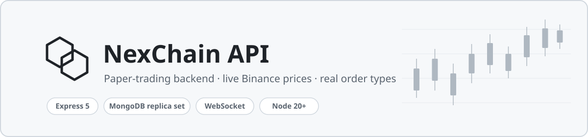
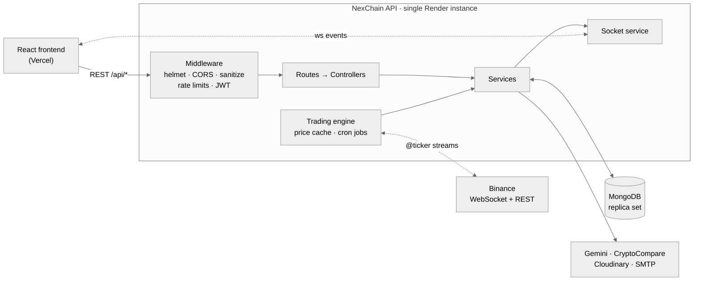
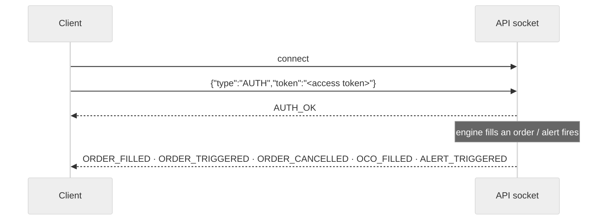

<div align="center">



<br>


**[Quick start](#quick-start)** &nbsp;·&nbsp; **[Architecture](#architecture)** &nbsp;·&nbsp; **[API](#api-reference)** &nbsp;·&nbsp; **[Configuration](#configuration)** &nbsp;·&nbsp; **[Deploy](#deploying-to-render)** &nbsp;·&nbsp; **[Help](#troubleshooting)**

<sub>Frontend lives in <a href="https://github.com/Arjunsathia/NexChain-FE">NexChain-FE</a></sub>

</div>

<br>

## Overview

NexChain is a crypto **paper-trading** platform. Every user starts with **$10,000 of virtual money**. They trade it against **live Binance prices** using the same order types a real exchange offers. No real funds are involved.

This repository is the API. It handles:

- accounts and sessions
- balances and trades
- the order-matching engine
- price alerts and real-time events
- the admin console's data

<table>
<tr>
<td width="50%" valign="top">

**For traders**

- Market buys and sells at the server's live price
- Limit, stop-limit, stop-market and **OCO** orders
- Price alerts by socket, in-app notification and email
- Portfolio history, leaderboard, watchlist, news
- AI assistant (Gemini) with live price and news lookups
- One-click **demo accounts**, no sign-up needed

</td>
<td width="50%" valign="top">

**For admins**

- User management: roles, freeze, delete
- Freeze or unfreeze individual coins
- KYC review with private document access
- Feedback and support inbox
- Platform stats and today's transactions
- Audit log, plus **2FA** for destructive actions

</td>
</tr>
</table>

<br>

## Contents

1. [Quick start](#quick-start)
2. [Architecture](#architecture)
3. [API reference](#api-reference)
4. [Data model](#data-model)
5. [Configuration](#configuration)
6. [Scripts](#scripts)
7. [Project structure](#project-structure)
8. [Deploying to Render](#deploying-to-render)
9. [Troubleshooting](#troubleshooting)

<br>

## Quick start

> **Requirements:** Node.js 20 or newer. Nothing else for development: `npm run dev` brings its own database.

```bash
npm install
cp .env.example .env     # fill in the required secrets (see Configuration)
npm run dev              # → http://localhost:4001
```

`npm run dev` sets up everything:

| Step | What happens |
|:--:|---|
| **1** | Starts a private **MongoDB replica set** on port `27027`. Its data goes in `.local-db/`, or in `LOCAL_DB_PATH` if set. |
| **2** | Seeds the dev accounts (below). |
| **3** | Runs the API with auto-reload (nodemon). |
| **4** | Blanks the Cloudinary and email keys, so nothing reaches real third-party accounts. |

**Dev accounts**, all with the password `Password123`:

| Username | Email | Role |
|---|---|---|
| `superadmin` | `superadmin@nexchain.local` | superadmin |
| `admin` | `admin@nexchain.local` | admin |
| `testuser` | `user@nexchain.local` | user |

**Ctrl+C stops everything.**

- If a previous run was killed instead, the next `npm run dev` cleans up its leftover processes.
- If a port is taken, it names the process and tells you how to stop it.
- If the database dies, it says so and stops the API too.

> [!TIP]
> Project inside **OneDrive or Dropbox**? Set `LOCAL_DB_PATH=C:/nexchain-db` (any folder outside the synced one) in `.env`. Syncing can lock MongoDB's files and crash it.

Prefer your own database (Atlas, or `mongod --replSet rs0`)? Set `MONGO_URI` in `.env` and run `npm run dev:own-db`.

<br>

## Architecture



### Request path

Requests flow **routes → controllers → services**.

- **`protect`** guards every route that touches user data. It checks the JWT and the user's `tokenVersion` against the database.
- **User-scoped actions** always use the logged-in user, never a `user_id` from the request.
- **Admin routes** add `adminOnly`. Destructive admin actions also require a 2FA code (`requireAdmin2FA`).

### Trading engine

`services/tradingEngine.js` runs inside the web process and drives everything time-based:

| Job | Runs | What it does |
|---|---|---|
| **Price feed** | always | One Binance WebSocket for every tracked coin, with REST fallbacks. It reconnects with backoff and switches hosts when one is blocked. |
| **Symbol sync** | every 30 s | Subscribes to coins that have open orders or active alerts. |
| **Order matching** | every 5 s | Fills pending orders whose coin has a price under 20 s old, oldest first, at most 500 per tick. |
| **Alert checks** | each price tick | Throttled to once per 2 s per coin. Each alert fires exactly once. |
| **Portfolio snapshots** | hourly | Data points for the performance chart. |
| **Demo purge** | hourly | Deletes expired demo accounts and all their data. |

While the database is unreachable, these jobs pause. They resume on reconnect, with one log line each way. Repeated errors collapse into one summary line every 30 s.

> [!IMPORTANT]
> Run **exactly one instance** with the engine on, or orders get processed twice. Set `ENGINE_ENABLED=false` on any extra instance.

### Money stays consistent

| Rule | How |
|---|---|
| **No partial updates** | Every balance change runs inside a MongoDB transaction with atomic updates (`utils/transactionHelpers.js`). This is why a replica set is required. |
| **No double fills** | An order is claimed and filled in the same transaction. OCO legs cancel each other atomically. |
| **No spoofed prices** | The Binance symbol is derived from the coin id on the server (`services/coinRegistry.js`), never taken from the client. |

### Real-time events



The token goes in the first message, never in the URL, where proxies and logs would record it. A socket that hasn't authenticated after 10 s is closed. A 30 s heartbeat drops dead connections.

### Sessions and security

| Area | Details |
|---|---|
| **Tokens** | 15-minute access tokens, plus a 30-day **httpOnly refresh cookie** that rotates on every use |
| **Revocation** | Logout, password change, freeze or role change bumps `tokenVersion`, which ends every session at once |
| **2FA** | TOTP, with secrets encrypted at rest using AES-256-GCM (`utils/secretBox.js`) |
| **Input** | Joi validation, Mongo operator sanitising, 100 kb body limit, helmet headers |
| **Rate limits** | Login, OTP, password reset, Google sign-in, refresh, feedback, demo creation, chat |
| **Files** | KYC documents go to private storage that only admins can read |

### Demo accounts

`POST /api/auth/demo` (5 per IP per hour) creates a private sandbox user with the usual $10k and signs in as it (`services/demoService.js`).

| | |
|---|---|
| **Can** | Trade, set alerts, use the watchlist |
| **Can't** (`blockDemo`) | Change email, username, phone or password; upload files; enable 2FA; submit KYC; email support |
| **Lifetime** | Hidden from the leaderboard. Sessions end after 24 h, then the hourly purge removes the account |

Set `DEMO_ENABLED=false` to turn the endpoint off.

<br>

## API reference

Every route lives under `/api`.  &nbsp;🔒 signed in &nbsp;·&nbsp; 🛡 admin

| Prefix | Purpose |
|---|---|
| `/auth` | Register, login, Google sign-in, email OTP, refresh, logout, password reset, demo |
| `/users` | Profile, settings, leaderboard · 🛡 user management |
| `/purchases` | 🔒 Market `buy` / `sell`, balance, holdings, transactions, performance, reset balance · 🛡 platform stats |
| `/orders` | 🔒 Create limit/stop orders, `create-oco`, update, cancel, list open orders |
| `/alerts` | 🔒 Create, list and delete price alerts |
| `/watchlist` | 🔒 Add, remove and list coins |
| `/notifications` | 🔒 List, mark read, clear |
| `/kyc` | 🔒 Submit documents and check status · 🛡 review, view the document, verify or reject |
| `/coins` | Frozen-coin list, start tracking a coin's price · 🛡 freeze and unfreeze |
| `/feedback` | Public feedback (validated, rate limited) · 🛡 inbox |
| `/news` | Crypto news (CryptoCompare) |
| `/chat` | AI assistant (Gemini, with live price and news tools) |
| `/2fa` | 🔒 Set up, verify and disable TOTP |
| `/health` | Public. Database and price-feed status; **503** when the database is down |

<br>

## Data model

| Model | Holds |
|---|---|
| `User` | Account, role, virtual balance, `tokenVersion`, 2FA, KYC status, demo flag |
| `PurchasedCoin` | Current holdings per user and coin |
| `Transaction` | Every fill, from market trades and orders |
| `Order` | `market`, `limit`, `stop_limit`, `stop_market` orders, with OCO links |
| `Alert` | Price alerts: `above` / `below`, `active` / `triggered` |
| `Notification` | In-app notifications |
| `PortfolioSnapshot` | Hourly equity points for the chart |
| `WatchList` · `FrozenCoin` · `Feedback` · `OTP` · `AuditLog` | Watchlist, admin coin freezes, support, email codes, admin audit trail |

<br>

## Configuration

`.env.example` documents every variable. The server **refuses to start** without the required ones.

**Required**

| Variable | Purpose |
|---|---|
| `MONGO_URI` | Replica-set connection string (set for you by `npm run dev`) |
| `JWT_SECRET`, `JWT_REFRESH_SECRET` | Access and refresh token signing. They must differ. Generate with `openssl rand -hex 32` |
| `OTP_SECRET` | Email verification codes |
| `TOTP_ENC_KEY` | Encrypts stored 2FA secrets. Changing it invalidates everyone's 2FA |

<details>
<summary><b>Production and integrations</b></summary>
<br>

| Variable | Needed for | Purpose |
|---|---|---|
| `CLIENT_URL`, `CORS_ORIGINS` | production | Frontend origin(s) allowed by CORS. `CLIENT_URL` is also used in email links |
| `CLOUDINARY_*` | production | Avatars and private KYC files. Without it, files go to local disk, which Render wipes on deploy |
| `EMAIL_USER`, `EMAIL_PASS`, `SMTP_*` | email | OTP, password reset and alert emails (Gmail needs an App Password) |
| `SUPPORT_EMAIL` | – | Inbox for "Contact support" (defaults to `EMAIL_USER`) |
| `GOOGLE_CLIENT_ID` | Google login | Must equal the frontend's `VITE_GOOGLE_CLIENT_ID` |
| `GEMINI_API_KEY` | AI chat | `GEMINI_MODELS` overrides the model fallback order |
| `CRYPTO_COMPARE_API_KEY` | – | Higher news-feed rate limit |
| `BINANCE_WS_URL` | – | Price-stream host to try first |

</details>

<details>
<summary><b>Switches and local development</b></summary>
<br>

| Variable | Purpose |
|---|---|
| `ENGINE_ENABLED` | `false` runs the API without the order engine and cron jobs |
| `DEMO_ENABLED` | `false` turns off demo accounts |
| `LOCAL_DB_PATH` | Data folder for `npm run dev`'s database (default `.local-db/`) |
| `LOCAL_AI` | `off` starts `npm run dev` with the AI assistant offline |

</details>

<br>

## Scripts

| Command | What it does |
|---|---|
| `npm run dev` | Local development: private database, seeded accounts, auto-reload |
| `npm run dev:own-db` | Auto-reload against the `MONGO_URI` in `.env` |
| `npm start` | Production start (what Render runs) |
| `npm test` | Jest + Supertest against an in-memory MongoDB replica set |
| `npm run lint` | ESLint |
| `npm run seed` | Create the dev accounts (refuses production and non-local databases) |
| `npm run audit:balances` | **Read-only** report of data left by the old exploits |
| `npm run migrate:orders` | One-time fix-up of old open orders. Dry run by default; add `-- --apply` to write |

CI runs lint and the full test suite on every push and pull request.

<br>

## Project structure

```text
NexChain-backend/
├── server.js        Express app, middleware, routes, startup, graceful shutdown
├── config/          env checks, DB connection, core coin list
├── Routes/          URL → middleware → controller
├── Controllers/     request handling
├── services/        trading engine, order execution, alerts, sockets, chat, equity, demo
├── Models/          Mongoose schemas
├── middleware/      auth (protect, adminOnly, blockDemo, 2FA), validation, rate limits, uploads
├── utils/           transactions, tokens, order locks, email, encryption, logging
├── scripts/         dev launcher, seed, audits, migrations
└── tests/           Jest suites: auth, trading, orders, KYC, security, sessions, alerts…
```

<br>

## Deploying to Render

`render.yaml` is a Render Blueprint for the web service.

1. **Create the service** from the blueprint and fill in the `sync: false` variables. JWT, OTP and TOTP secrets are generated for you.
2. **Set `CLIENT_URL`** (plus `CORS_ORIGINS` for several origins) to the deployed frontend URL.
3. **Prepare Atlas:**
   - Create a dedicated database user.
   - Allow Render's outbound IPs (or `0.0.0.0/0` with a strong password).
   - Turn on backups.
4. **Keep one instance.** The health check is `GET /api/health`. On SIGTERM the server finishes in-flight work before exiting.

> [!WARNING]
> **Before the first production deploy of this hardened version:**
> 1. Back up the database.
> 2. Run `npm run audit:balances`.
> 3. Run `npm run migrate:orders`, review the dry run, then run it again with `-- --apply`.
>
> Everyone will need to log in once, because the token format changed.

<br>

## Troubleshooting

<details>
<summary><b>A flood of <code>connect ECONNREFUSED 127.0.0.1:27027</code></b></summary>
<br>

The local dev database stopped while the API kept running. Press Ctrl+C and run `npm run dev` again. The launcher now notices this itself and stops the API.

If it keeps happening and the project is in OneDrive or Dropbox, set `LOCAL_DB_PATH` to a folder outside it.
</details>

<details>
<summary><b><code>Port 4001</code> or <code>27027</code> is already in use</b></summary>
<br>

Another copy is still running. The error names the process and gives the exact `taskkill` (Windows) or `kill` command to stop it.
</details>

<details>
<summary><b>Trades fail with a transaction error</b></summary>
<br>

Your MongoDB is a standalone server. Trades need a replica set: use `npm run dev`, Atlas, or `mongod --replSet rs0`.
</details>

<details>
<summary><b>No live prices</b></summary>
<br>

That Binance host is probably blocked on your network. The engine switches hosts on its own, and you can pin one with `BINANCE_WS_URL`. `GET /api/health` → `priceFeed` shows the current state.
</details>

<details>
<summary><b>The AI assistant says it's busy</b></summary>
<br>

Gemini is rate limiting or overloaded. The assistant falls back through `GEMINI_MODELS` and skips a failing model for a minute. Start dev with `LOCAL_AI=off` to work without it.
</details>

<br>

<div align="center">
<sub>Part of NexChain · <a href="https://github.com/Arjunsathia/NexChain-FE">Frontend</a> · <a href="https://github.com/Arjunsathia/NexChain-backend">Backend</a></sub>
</div>
